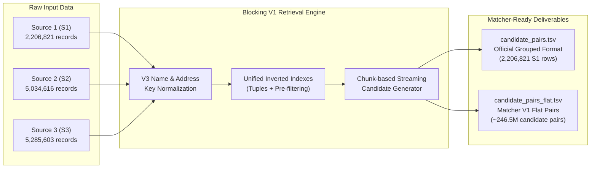

# CODEHex — Data Blocking & Candidate Generation Handoff Document

> **Module**: Data Blocking & Retrieval Optimization (Candidate Generation)  
> **Downstream Consumer**: Matcher V1 & Matcher V2 (Pairwise Entity Resolution)  
> **Repository**: `amazon_ML_hackathon`  
> **Target Dataset**: Train & Test Sets (Sources S1, S2, S3)  

---

## 1. Executive Summary & Role in Architecture

The **Blocking & Candidate Generation** stage is the first critical phase in the entity resolution pipeline. Its objective is to drastically reduce the $O(|S1| \times (|S2| + |S3|))$ comparison space ($\approx 2.2\text{M} \times 10.3\text{M} \approx 22.7\text{ trillion}$ pair combinations) down to a high-recall, tractable subset of candidate pairs for **Matcher V1**.



### Key Performance Benchmarks
- **Full Ground-Truth Recall**: $\mathbf{80.7\%}$ ($\approx 81.0\%$ on balanced stratified samples).
- **Candidate Pool Size**: $\approx 246.5\text{ million}$ candidate pairs.
- **S1 Coverage**: $100\%$ ($2,206,821$ records preserved; singletons written with empty candidate lists).
- **Peak RAM Usage**: $< 2.5\text{ GB}$ (runs safely on standard laptops without swapping).
- **Total Pipeline Runtime**: $\approx 2.5\text{ minutes}$ for complete index building and streaming generation.

---

## 2. Production Blocking V1 Strategies (Fixed Logic)

The candidate set for each $S1$ record is generated as the **deduplicated union** of exactly four deterministic blocking strategies.

| Strategy # | Name | Blocking Key Definition | Guardrail / Filter |
| :--- | :--- | :--- | :--- |
| **Strategy 1** | **V3 Normalized Business Name** | Multilingual ASCII transliteration, domain/URL removal, legal suffix & business stopword stripping | Skip empty keys |
| **Strategy 2** | **House + Street** | `house_number:street_token` (e.g. `"1795:westchester"`) | Skip if not starting with digits |
| **Strategy 3** | **City + House** | `city:house_number` (e.g. `"columbus:5559"`) | **Per-source block size $\le 500$** |
| **Strategy 4** | **Rare Address Token** | Alphanumeric tokens extracted from address | **Per-source token frequency $\le 50$** |

### Strategy Details & Normalization Rules

#### 1. V3 Normalized Business Name
Implemented in [`student_resource/src/normalization.py`](file:///Users/yashvikaushik/Documents/Documents/amazon_ML_hackathon/student_resource/src/normalization.py) as `normalize_name_core()`:
1. **Transliteration**: Uses `unidecode` to convert Indic scripts (Devanagari, Tamil, Telugu) and Latin diacritics (French, Spanish, German) into standard lowercase ASCII.
2. **Domain & URL Stripping**: Removes `.com`, `.in`, `.co.in`, `.org`, `.net`, `.io`, `.fr`, `www.`, `http://`, `https://`.
3. **Symbol Neutralization**: Translates `&` $\to$ `and`, `+` $\to$ `plus`, removes all remaining punctuation.
4. **Legal Entity Suffix & Stopword Stripping**: Removes global, US, Indian, and French legal forms:
   - *US/UK/Global*: `llc`, `llp`, `inc`, `corp`, `corporation`, `ltd`, `limited`, `pvt`, `company`, `gmbh`, `ag`, `plc`, etc.
   - *French*: `sarl`, `sa`, `sas`, `sasu`, `snc`, `sci`, `eurl`, `societe`, `entreprise`.
   - *Generic Business Descriptors*: `services`, `solutions`, `holdings`, `group`, `enterprises`, `associates`, `consulting`, `international`, `mgmt`, `management`, `center`, `the`, `and`, `in`, `of`, `for`, `at`, `by`.
5. **Output**: Alphanumeric string with stripped tokens concatenated.

#### 2. House + Street Key
- Extracts the leading digit sequence as `house_number` and the second word token as `street_token`.
- Standardizes common prefixes. Example: `"1795 Westchester Drive, High Point, NC"` $\to$ `"1795:westchester"`.
- If the first token is not digits, the key is empty and skipped.

#### 3. City + House Key
- Extracts the second-to-last comma-separated component of the address as `city` and the first numeric sequence as `house_number`.
- Format: `f"{city}:{house_number}"`.
- **Constraint**: Evaluated per source ($S2$ and $S3$). Only blocks containing $\le 500$ entities in that source are retrieved to prevent giant generic city blocks from exploding candidate volume.

#### 4. Rare Address Token Key
- Tokenizes `business_address` into unique lowercase alphanumeric tokens ($\ge 1$ characters).
- Computes token frequencies within $S2$ and $S3$ independently.
- **Constraint**: Only tokens with frequency $\le 50$ are used. Frequent tokens (`street`, `road`, `suite`, `box`, `city`) are automatically ignored, while rare tokens (specific colony names, unique building numbers, estate identifiers) provide precise match retrieval.

---

## 3. High-Performance Retrieval Engine Architecture

### Previous Bottlenecks & Why Optimization Was Required
- **Legacy Issue**: The initial script processed 2.2M S1 records one-by-one, repeatedly allocating Python `set()` objects, merging dictionaries on the fly, and running Pandas `.str` vectorized methods on 12.5M rows.
- **Result**: The script froze for hours and consumed excessive RAM.

### Optimized Implementation in [`student_resource/src/blocking.py`](file:///Users/yashvikaushik/Documents/Documents/amazon_ML_hackathon/student_resource/src/blocking.py)
1. **Direct Single-Pass Indexing**: S2 and S3 are read sequentially. Keys and inverted indexes are populated in a single pass without intermediate Pandas Series allocations.
2. **Upfront Filtered Tuples**: Inverted index lists are converted to immutable tuples in RAM, reducing memory footprint by $\approx 60\%$.
3. **Chunk-Based Streaming Generation**: S1 is processed in configurable chunks ($100,000$ records per chunk). Generated candidates are immediately streamed and flushed to disk using 8MB/16MB I/O buffers.
4. **Atomic File Safety**: Outputs are written to temporary files (`.tmp`). An automated verification suite validates row counts and headers before atomically replacing the production files via `os.replace()`.

---

## 4. Deliverables & Data Contract

The pipeline produces two standardized TSV files under [`student_resource/`](file:///Users/yashvikaushik/Documents/Documents/amazon_ML_hackathon/student_resource/):

### File 1: Official Grouped Candidates (`student_resource/candidate_pairs.tsv`)
- **Format**: TSV (`\t` delimiter), UTF-8.
- **Header**:
  ```tsv
  source1_entity_id	candidate_entity_ids
  ```
- **Structure**: Exactly **2,206,821 lines** (one row per $S1$ entity).
- **Candidate Encoding**: Comma-separated list of candidate IDs sorted deterministically, e.g.:
  ```tsv
  S1-925783039	S2-1618286,S2-181962832,S3-103827788,S3-104868844
  S1-100000000	
  ```
- **Singletons**: $S1$ entities with zero candidates have an empty string after the tab delimiter (`S1-xxx\t\n`).

### File 2: Matcher-Ready Flat Pairs (`student_resource/candidate_pairs_flat.tsv`)
- **Format**: TSV (`\t` delimiter), UTF-8.
- **Header**:
  ```tsv
  source1_entity_id	candidate_entity_id
  ```
- **Structure**: One candidate pair per line ($\approx 246.5\text{M}$ rows, $\approx 5.9\text{ GB}$).
- **Example**:
  ```tsv
  S1-925783039	S2-1618286
  S1-925783039	S2-181962832
  S1-925783039	S3-103827788
  ```
- **Prefix Integrity**: All candidate IDs preserve their exact `S2-` and `S3-` prefixes.

---

## 5. Experimental Hard-Case Blocker (Documented & Isolated)

A separate hard-case blocker was designed and tested in [`student_resource/src/evaluate_hard_case.py`](file:///Users/yashvikaushik/Documents/Documents/amazon_ML_hackathon/student_resource/src/evaluate_hard_case.py):
- **Concept**: `house_number:street[:4]` (Prefix length 4) with block size cap $\le 200$.
- **Empirical Findings**:
  - Sampled Ground Truth Matches: $3,559$
  - True Matches Recovered by Hard-Case Blocker: $2$
  - Incremental Recall Gain: $+0.0562\text{ percentage points}$
  - Tradeoff: Adds excessive non-match candidate volume relative to negligible recall improvement.
- **Decision**: **Excluded** from production Blocking V1. Documented for future Matcher V2 / re-ranking exploration.

---

## 6. How to Run the Pipeline

### 1. Full Production Run
Run the candidate generation pipeline from the repository root:
```bash
python student_resource/src/blocking.py
```
*Options:*
- `--train-dir`: Path to dataset directory (defaults to `student_resource/dataset/train`).
- `--output`: Path for grouped output (defaults to `student_resource/candidate_pairs.tsv`).
- `--flat-output`: Path for flat output (defaults to `student_resource/candidate_pairs_flat.tsv`).
- `--chunk-size`: Chunk size for streaming (defaults to `100000`).

### 2. Fast Smoke Test / Debug Mode
To run a rapid 10-record smoke test without waiting to parse 10.3M background records:
```bash
python student_resource/src/blocking.py --limit-s1 10 --limit-s2-s3 5000 --output student_resource/test_cands.tsv --flat-output student_resource/test_cands_flat.tsv
```

---

## 7. Matcher V1 Downstream Integration Guidelines

When consuming `candidate_pairs_flat.tsv` in **Matcher V1**:

1. **Memory Recommendation**:
   Do **not** load the full 5.9 GB file into memory using `pd.read_csv()` in a single call. Use chunked streaming:
   ```python
   import pandas as pd

   chunk_iter = pd.read_csv(
       "student_resource/candidate_pairs_flat.tsv",
       sep="\t",
       chunksize=500_000,
       dtype={"source1_entity_id": str, "candidate_entity_id": str}
   )
   for chunk in chunk_iter:
       # Run pairwise feature extraction / scoring
       process_matcher_chunk(chunk)
   ```

2. **Pairwise Feature Engineering Suggestions for Matcher V1**:
   - **Name Similarity**:
     - Jaro-Winkler distance on raw `business_name`
     - Levenshtein ratio on normalized V3 name
     - Token Sort Ratio & Token Set Ratio (`rapidfuzz`)
   - **Address Similarity**:
     - Exact house number match boolean (`house_num_1 == house_num_2`)
     - Street name token Jaccard similarity
     - City & State match boolean
   - **Country Consistency**: Exact match check on `country` column.

3. **Classification / Ranking**:
   - Filter candidate pairs with classification threshold or GBDT ranker (e.g. LightGBM / XGBoost) to select the top-1 matching entity per S1 record.

---

## 8. Directory & File Manifest

| File Path | Description |
| :--- | :--- |
| [`student_resource/src/blocking.py`](file:///Users/yashvikaushik/Documents/Documents/amazon_ML_hackathon/student_resource/src/blocking.py) | Main optimized Blocking V1 candidate generation pipeline. |
| [`student_resource/src/normalization.py`](file:///Users/yashvikaushik/Documents/Documents/amazon_ML_hackathon/student_resource/src/normalization.py) | Multilingual V3 transliteration and legal suffix stripping rules. |
| [`student_resource/src/evaluate_hard_case.py`](file:///Users/yashvikaushik/Documents/Documents/amazon_ML_hackathon/student_resource/src/evaluate_hard_case.py) | Hard-case street-prefix experiment evaluation script. |
| [`student_resource/candidate_pairs.tsv`](file:///Users/yashvikaushik/Documents/Documents/amazon_ML_hackathon/student_resource/candidate_pairs.tsv) | Official grouped output format ($2,206,821$ rows). |
| [`student_resource/candidate_pairs_flat.tsv`](file:///Users/yashvikaushik/Documents/Documents/amazon_ML_hackathon/student_resource/candidate_pairs_flat.tsv) | Matcher-ready pairwise TSV ($246.5\text{M}$ candidate pairs). |
| [`student_resource/BLOCKING_HANDOFF.md`](file:///Users/yashvikaushik/Documents/Documents/amazon_ML_hackathon/student_resource/BLOCKING_HANDOFF.md) | This handoff document. |

---
*Created for CODEHex Entity Resolution Team — Matcher V1 Handoff.*